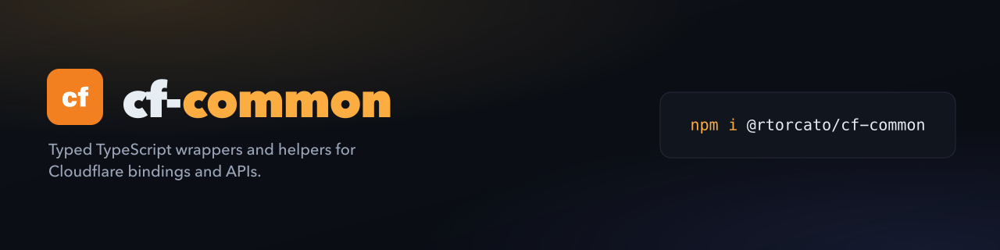

<!-- brand-kit:banner:start -->
<picture>
  <source media="(max-width: 640px)" srcset="./brand/banner-mobile.png">
  
</picture>
<!-- brand-kit:banner:end -->

# cf-common

[](https://github.com/rtorcato/cf-common/actions/workflows/ci.yml)
[](https://www.npmjs.com/package/@rtorcato/cf-common)
[](https://www.npmjs.com/package/@rtorcato/cf-common)
[](https://bundlephobia.com/package/@rtorcato/cf-common)
[](https://docs.torcato.dev/cf-common/)
[](./LICENSE)

[](https://buymeacoffee.com/rtorcato)

Typed TypeScript wrappers and helpers for working with Cloudflare bindings and
APIs — in the spirit of [`js-common`](https://docs.torcato.dev/js-common/) and
[`browser-common`](https://docs.torcato.dev/browser-common/).

Each module is a **thin, well-typed convenience layer** over a Cloudflare
service — not a framework. Tree-shakeable subpath exports, zero required runtime
dependencies, built for the Workers (workerd) runtime.

## Install

```sh
pnpm add @rtorcato/cf-common
```

**Requirements:** a Cloudflare Workers project (Wrangler). TypeScript ≥ 5.0 is
recommended — every public API ships with strict types and JSDoc.

## Quick start

```ts
import { getBinding, requireEnv } from '@rtorcato/cf-common/env'
import { createKvStore } from '@rtorcato/cf-common/kv'
import { toCloudflareError } from '@rtorcato/cf-common/errors'

interface User {
  id: number
  name: string
}

export default {
  async fetch(req: Request, env: Record<string, unknown>): Promise<Response> {
    try {
      // Throws a 500 if the binding is missing — a deploy misconfiguration,
      // not a client error.
      const users = createKvStore<User>(getBinding(env, 'USERS'))

      const user = await users.get('u:42') // User | null, JSON-parsed
      if (!user) return Response.json({ error: 'Not found' }, { status: 404 })

      return Response.json(user)
    } catch (err) {
      const e = toCloudflareError(err)
      return Response.json(
        { error: e.expose ? e.message : 'Internal error', code: e.code },
        { status: e.status }
      )
    }
  },
}
```

## Modules

Each module is a separate subpath import, so you ship only what you use.

| Subpath | Description | Status |
| --- | --- | --- |
| [`@rtorcato/cf-common/errors`](https://docs.torcato.dev/cf-common/docs/api/errors) | `CloudflareError` (HTTP `status` + `expose` + `code`), `isCloudflareError`, `toCloudflareError` | ✅ Shipped |
| [`@rtorcato/cf-common/env`](https://docs.torcato.dev/cf-common/docs/api/env) | `getBinding`, `requireEnv`, `getEnv` — typed access to Worker bindings and vars | ✅ Shipped |
| [`@rtorcato/cf-common/kv`](https://docs.torcato.dev/cf-common/docs/api/kv) | `createKvStore` — typed JSON get/put/delete/list with TTL + metadata | ✅ Shipped |
| `@rtorcato/cf-common/ratelimit` | `rateLimit` — typed Rate Limiting binding wrapper with IP / identifier keys | ✅ Shipped |
| [`@rtorcato/cf-common/access`](https://docs.torcato.dev/cf-common/docs/api/access) | `verifyAccessJwt` + `accessJwt` — verify the Cloudflare Access JWT assertion against the team JWKS | ✅ Shipped |
| [`@rtorcato/cf-common/ai`](https://docs.torcato.dev/cf-common/docs/api/ai) | `runAi` — typed Workers AI `run()`, input and output types picked by model name | ✅ Shipped |
| [`@rtorcato/cf-common/vectorize`](https://docs.torcato.dev/cf-common/docs/api/vectorize) | `createVectorStore` — typed metadata, upserts chunked at 1000, and failures mapped to `CloudflareError` | ✅ Shipped |
| [`@rtorcato/cf-common/hyperdrive`](https://docs.torcato.dev/cf-common/docs/api/hyperdrive) | `withHyperdrive` — per-request client over a Hyperdrive binding, always closed; driver-agnostic | ✅ Shipped |
| [`@rtorcato/cf-common/r2`](https://docs.torcato.dev/cf-common/docs/api/r2) | `createR2Store` + `multipartUpload` — object helpers and a multipart driver | ✅ Shipped |
| [`@rtorcato/cf-common/r2-presign`](https://docs.torcato.dev/cf-common/docs/api/r2-presign) | `presignR2Url` — presigned `GET`/`PUT` URLs over R2's S3 API (SigV4, Web Crypto) | ✅ Shipped |
| [`@rtorcato/cf-common/cache`](https://docs.torcato.dev/cf-common/docs/api/cache) | `createCache` + `buildCacheKey` — Cache API `match`/`put`/`delete` with key-builder and TTL | ✅ Shipped |
| [`@rtorcato/cf-common/queues`](https://docs.torcato.dev/cf-common/docs/api/queues) | `createProducer` + `defineQueue` — typed Queue producer with 100-message chunking, and a consumer that acks or retries each message | ✅ Shipped |
| [`@rtorcato/cf-common/do`](https://docs.torcato.dev/cf-common/docs/api/do) | `BaseDurableObject` + `typedStorage` — Durable Object base class with key-checked `get`/`put`/`delete` | ✅ Shipped |
| [`@rtorcato/cf-common/d1`](https://docs.torcato.dev/cf-common/docs/api/d1) | `query`/`queryFirst`/`execute`/`batch` + idempotent `runMigrations` | ✅ Shipped |

More land incrementally (HTTP, Request, Queues, Durable Objects, Cache, Workers
AI, …). See the [milestones](https://github.com/rtorcato/cf-common/milestones)
for the roadmap, or the
[Beta milestone](https://github.com/rtorcato/cf-common/milestone/1) for what's next.

## Use with AI

A skill ships with the package so AI coding tools use cf-common the way it's
meant to be used: subpath imports, the `CloudflareError` / `defineFetch` error
contract, and each module's API.

**Any agent with the [`skills`](https://www.npmjs.com/package/skills) CLI**: install it
straight from GitHub, no clone, no package install:

```sh
npx skills add https://github.com/rtorcato/cf-common --skill cf-common
```

**[Claude Code](https://claude.com/claude-code)**: register the marketplace once, then
install the plugin:

```sh
/plugin marketplace add rtorcato/cf-common
/plugin install cf-common@cf-common
```

**Other tools (Cursor, Copilot, Codex)**: the package ships an [`AGENTS.md`](AGENTS.md)
with the same rules. Agents that read `AGENTS.md` pick it up from `node_modules`, or
copy the rules into your project's agent config.

## Documentation

Full docs and the per-module API reference live at
**[docs.torcato.dev/cf-common](https://docs.torcato.dev/cf-common/)**.

## Development

```sh
pnpm install
pnpm verify        # typecheck + biome + tests
pnpm build         # tsup → dist/ (ESM, per-module subpaths)
pnpm test:watch    # vitest in watch mode
```

Commits follow [Conventional Commits](https://conventionalcommits.org/).
Releases use [Changesets](https://github.com/changesets/changesets): add one with
`pnpm changeset` for any user-facing change. Merging to `main` opens a "Version
Packages" PR, and merging that PR publishes after one approval in the `release`
environment.

## License

[MIT](./LICENSE) © Richard Torcato
